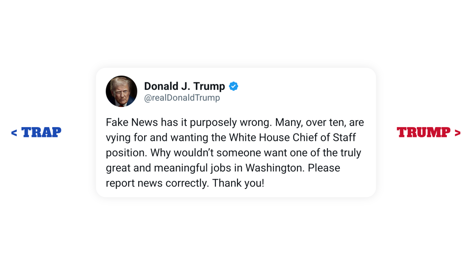
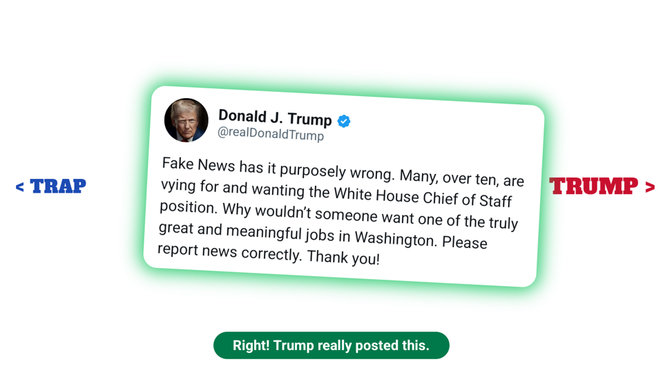
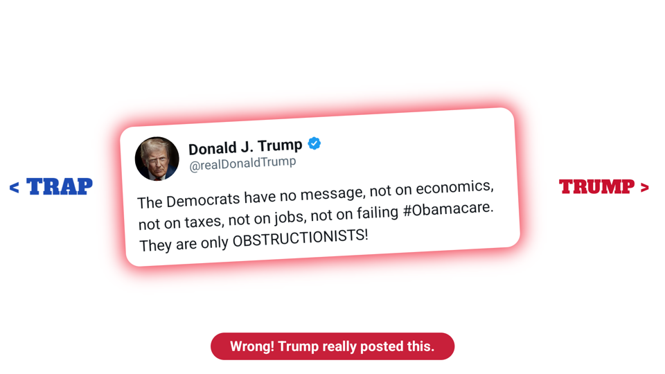
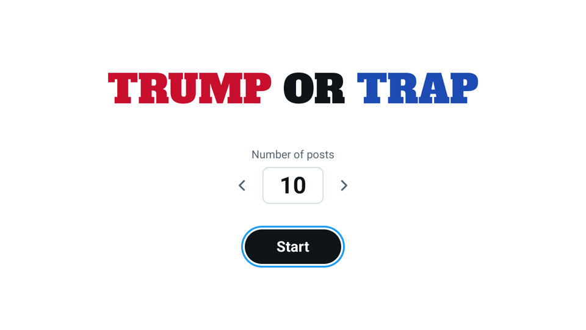
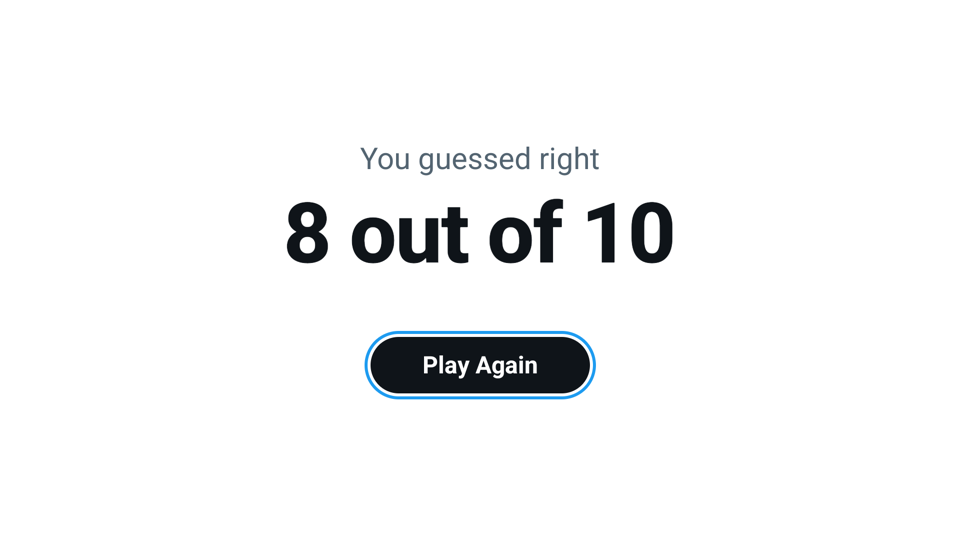

# Trump or Trap

**Did he really post that?** A guessing game for Android TV. A Donald Trump post
appears on screen and you have one press of the remote to decide: did he actually post it, or
is it a trap written to sound just like him?

<p align="center">
  
</p>

## How to play

1. **Pick a game length.** Press up to select the number and left or right to choose 5, 10, 20
   or 50 posts. Then press down and OK to **Start**.
2. **Read the post.** Press **right for TRUMP** if you think he really posted it, or **left for
   TRAP** if you think it's a fake.
3. **See how you did.** The card swings to the side you picked and glows green if you were
   right or red if you were wrong, and a short message tells you whether he posted it. Wait a
   moment, or press any direction or OK to go straight to the next post.
4. **Check your score** at the end, then play again. While the app stays open, you won't see
   the same post twice until you've been through the whole deck.

| Right answer | Wrong answer |
| :---: | :---: |
|  |  |

| Title screen | Score |
| :---: | :---: |
|  |  |

## What's in the deck

There are 2,950 posts, half real and half fake:

- **Real posts** come from his Twitter account (2009–2021) and Truth Social (2022–2026).
- **Fake posts** were written for this game to match his style and topics from each period.
  Real and fake posts are matched for length and punctuation, so you can only tell them apart
  by what they say.

## Install it on your TV

Trump or Trap isn't on the Play Store. Download the APK from the
[latest release](https://github.com/jjmluz/trump-or-trap/releases/latest) and sideload it onto
any Android TV or Google TV device running Android 9 or later. Newer releases install over older
ones.

There are two common ways to sideload:

- **From the TV:** install a file manager or downloader app on the TV, open the APK with it, and
  allow it to install unknown apps when asked.
- **From a computer with `adb`:** turn on
  [developer options and USB or network debugging](https://developer.android.com/studio/debug/dev-options)
  on the TV, install the
  [Android SDK platform tools](https://developer.android.com/tools/releases/platform-tools), and
  run:

  ```bash
  adb connect <tv-ip-address>:5555
  adb install -r trump-or-trap-<version>.apk
  ```

### Build it yourself

Gradle needs JDK 17 or later; Android Studio's bundled JDK works. Create `local.properties` with
`sdk.dir=/path/to/your/Android/sdk`, then:

```bash
export JAVA_HOME="/Applications/Android Studio.app/Contents/jbr/Contents/Home"
./gradlew :app:assembleRelease
adb install -r app/build/outputs/apk/release/app-release.apk
```

A release build you make yourself is signed with your own debug key, so it can't update a copy
installed from GitHub (or the other way round). Uninstall one before installing the other.

## Development

The game is written in Kotlin with Jetpack Compose for TV.

| Path | What's there |
|---|---|
| `app/src/main/java/com/jjmluz/trumportrap/game/` | Game rules and the deck, in plain Kotlin with no Android code |
| `app/src/main/java/com/jjmluz/trumportrap/ui/` | Screens, theme, sounds and the view model |
| `data/fakes/*.txt` | The fake posts, one `YEAR\|text` per line |
| `data/out/game_deck.json` | The deck the app ships, copied into the app at build time |
| `scripts/` | The data pipeline and the sound generator |
| `docs/screenshots/` | The screenshots in this README (real posts only) |

Run the unit tests:

```bash
./gradlew :app:testDebugUnitTest
```

Every push and pull request runs lint, the tests and a release build on GitHub Actions. Pushing
a tag like `v1.0.0` also publishes a GitHub release with the APK.

### Rebuilding the deck

The deck is committed, so you only need this after changing the fake posts or refreshing the
real ones. Use Python 3 in a virtualenv:

```bash
pip install -r scripts/requirements.txt
python scripts/build_real_posts.py data
python scripts/build_fake_posts.py data
```

The first script downloads the real posts into `data/raw/` and picks the real cards. The second
checks every fake against the real posts (rejecting any that copy too much of one), matches real
and fake cards for length and style, and writes `data/out/game_deck.json`.

## License

The code is under the [MIT License](LICENSE). The license doesn't cover the real posts, which
are quoted from the sources below, or the bundled font, which has its own license.

## Credits

- Real Twitter posts (2009–2021): [`fschlatt/trump-tweets`](https://huggingface.co/datasets/fschlatt/trump-tweets)
  on Hugging Face, released under CC0 1.0.
- Real Truth Social posts (2022–2026): CNN's [Truth Social archive](https://ix.cnn.io/data/truth-social/truth_archive.json).
  Each real card keeps a link to the original post.
- Posts by Donald J. Trump are quoted for a non-commercial guessing game. The fake posts in
  `data/fakes/` were written for this project and were never posted by him.
- Avatar (`profile.jpg`): official presidential portrait, 2025, by Daniel Torok, White House
  ([Wikimedia Commons](https://commons.wikimedia.org/wiki/File:Official_Presidential_Portrait_of_President_Donald_J._Trump_(2025)_(square_cropped).jpg)).
  A work of the U.S. federal government, in the public domain.
- Title font: [Alfa Slab One](https://fonts.google.com/specimen/Alfa+Slab+One), SIL Open Font
  License 1.1 (see `licenses/`).
